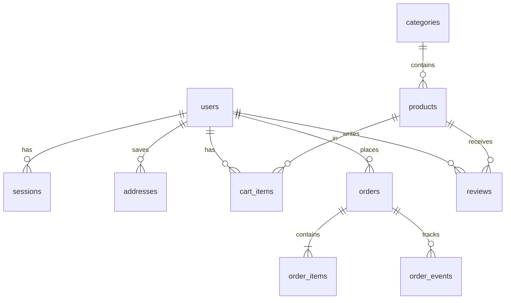

# 🛍️ Flipcart – E-commerce web app (Python + Flask + SQLite)

A Flipkart-style online shop: product catalogue with smart search & filters, product pages with reviews,
cart with coupons, checkout with addresses & payment options, **orders with tracking and cancellation**,
and an **admin panel** for managing orders and products.

## Run it
Requires **Python 3.9+**.

    python3 -m venv .venv && source .venv/bin/activate      # Windows: .venv\Scripts\activate
    pip install -r requirements.txt
    python app.py                                            # open http://localhost:8000

(or double-click `Open_Flipcart.command` on Mac / `Open_Flipcart.bat` on Windows)

Run the automated tests: `python -m unittest discover tests -v`

**Admin login (local demo):** admin@flipcart.com / admin123 → Admin Panel (top-right menu). When deployed, set the `ADMIN_PASSWORD` environment variable.
**Coupons:** FIRST50 (50% up to ₹150, min ₹299) · SAVE20 (20% up to ₹300, min ₹999) · FLIP10 (10% up to ₹100).

## Real photos & going online
* **Real product photos:** run `Get_Real_Images.command` / `.bat` (or `python fetch_images.py`) – see `DEPLOY.md`.
* **Deploy online (free):** step-by-step for PythonAnywhere and Render in **`DEPLOY.md`**.

## Troubleshooting
* **"Failed to fetch" / "Cannot reach the server" / no product images** – the Python server is not running.
  Start it with `Open_Flipcart` (keep its window open) or `python app.py`, then use http://localhost:8000.
  Opening `index.html` by double-click also works now, but only while the server is running.
* **Port 8000 already in use** – close the other Flipcart window and start again.
* **Windows: "Python is not installed"** – install from python.org and tick *Add Python to PATH*.

## Features
| Area | What it does |
|---|---|
| Home | category strip, auto-rotating banner, "Best of …" product rows |
| Search | plurals + synonyms ("shoes", "phones", "electric devices"), auto-suggest dropdown |
| Listing | filters (category, price, rating) and sorting (popularity, price, rating, discount, newest) |
| Product page | price/discount, offers, delivery-date check by pincode, reviews & ratings, similar products |
| Cart | quantity stepper with stock limits, coupon codes, price-details box (MRP, discount, coupon, delivery) |
| Checkout | saved addresses, order summary, **payment step**: UPI / Card / Net Banking forms with validation, processing screen, success or decline, transaction ID, Cash on Delivery |
| Orders | order history, search + status filter, tracking timeline, cancel (restocks items, marks refund) |
| Admin | dashboard (revenue, status counts, top sellers, low stock), update order status, add products, edit price/MRP/stock |
| Security | hashed passwords (Werkzeug), bearer-token sessions, per-user data isolation, admin-only routes, input validation |

## Project structure
    app.py          Flask REST API (all routes)
    fetch_images.py downloads real product photos (Wikimedia / Pexels)
    wsgi.py, Procfile, render.yaml   deployment files (see DEPLOY.md)
    database.py     SQLite schema + seed data (37 products, categories, promos, admin user)
    requirements.txt
    tests/          unittest suite for the API
    public/         frontend (served by Flask): HTML pages, css/style.css, js/*.js, images/ (SVG product images)

## Database (ER diagram)

Tables: `users, sessions, categories, products, reviews, cart_items, addresses, promos, orders, order_items, order_events`.
Order items store a snapshot of name/price so history stays correct if a product changes later.

## Payments (test mode)
Implemented in `payments.py` as a simulated gateway that behaves like Razorpay/Stripe test mode. **No real money is charged.**
* Payment is taken **before** the order is created – a failed payment creates no order, keeps the cart and does not touch stock.
* Card numbers are checked with the Luhn algorithm, expiry and CVV are validated; only brand + last 4 digits are stored, never the full number or CVV.
* Every attempt (success or failure) is logged in the `payments` table with a transaction id. Cancelling a paid order marks it `REFUNDED`.
* Test values: card `4111 1111 1111 1111` ✓ · `4000 0000 0000 0002` declined · `4000 0000 0000 9995` insufficient funds · UPI `fail@upi` declined · bank *State Bank of India* fails.
* To accept real money, replace `payments.charge()` with a Razorpay/Stripe call (needs a merchant account and API keys).

## Order lifecycle
`PLACED → PACKED → SHIPPED → OUT_FOR_DELIVERY → DELIVERED` (customer may cancel while PLACED/PACKED → `CANCELLED`, stock is restored).
Every change is written to `order_events`, which powers the tracking timeline.

## REST API
Auth = `Authorization: Bearer <token>` (returned by login/signup).

| Method | Endpoint | Auth | Purpose |
|---|---|---|---|
| POST | /api/auth/signup · /api/auth/login | – | create account / log in |
| GET | /api/auth/me · POST /api/auth/logout | ✓ | current user / end session |
| GET | /api/categories | – | list categories |
| GET | /api/products?q=&category=&min_price=&max_price=&rating=&sort=&limit= | – | search / filter / sort |
| GET | /api/products/:id | – | detail + reviews + related + offers |
| POST | /api/products/:id/reviews | ✓ | add rating & review |
| GET | /api/suggest?q= | – | search suggestions |
| GET | /api/delivery?pincode= | – | delivery estimate |
| GET | /api/cart?promo= | ✓ | cart + price details |
| POST | /api/cart | ✓ | add `{productId, quantity}` |
| PATCH / DELETE | /api/cart/:productId | ✓ | set quantity / remove |
| GET / POST | /api/addresses | ✓ | list / add address |
| DELETE | /api/addresses/:id | ✓ | delete address |
| POST | /api/orders | ✓ | place order `{address_id, payment_method, promo}` |
| GET | /api/orders · /api/orders/:id | ✓ | order history / one order |
| POST | /api/orders/:id/cancel | ✓ | cancel order |
| GET | /api/admin/stats · /api/admin/orders | admin | dashboard / all orders |
| PATCH | /api/admin/orders/:id/status | admin | move order to next status |
| POST / PATCH | /api/admin/products[/:id] | admin | add product / edit price, MRP, stock |

## Notes / limits (good points for your viva)
* Payments are simulated (test mode). Integrate Razorpay/Stripe in `payments.py` for real money.
* SQLite is perfect for a demo; swap for PostgreSQL/MySQL for real traffic.
* Product images are generated SVGs. To use real photos put files in `public/images` and update `products.image`
  (or paste a URL in the admin "Add product" form).
* Change the default admin password before deploying anywhere public.
